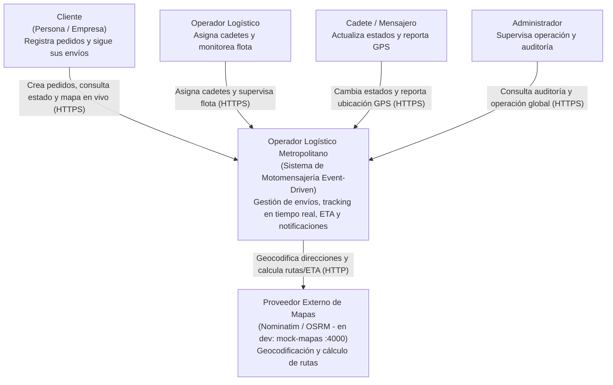
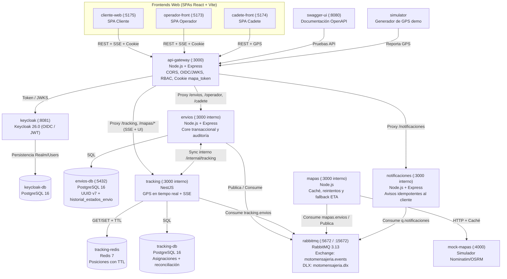
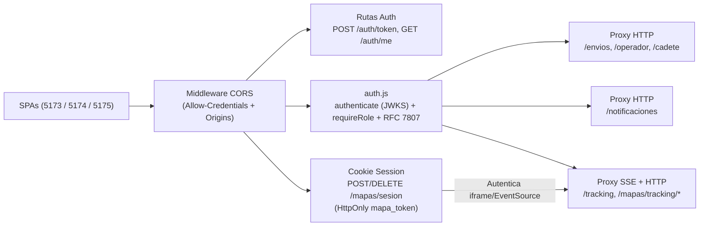
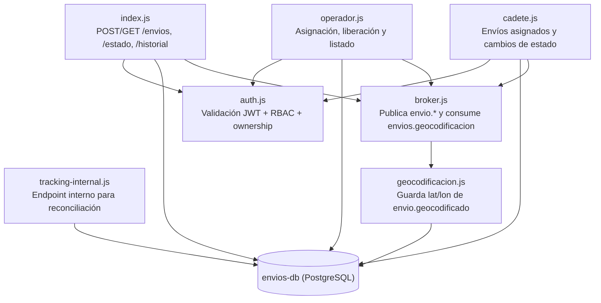
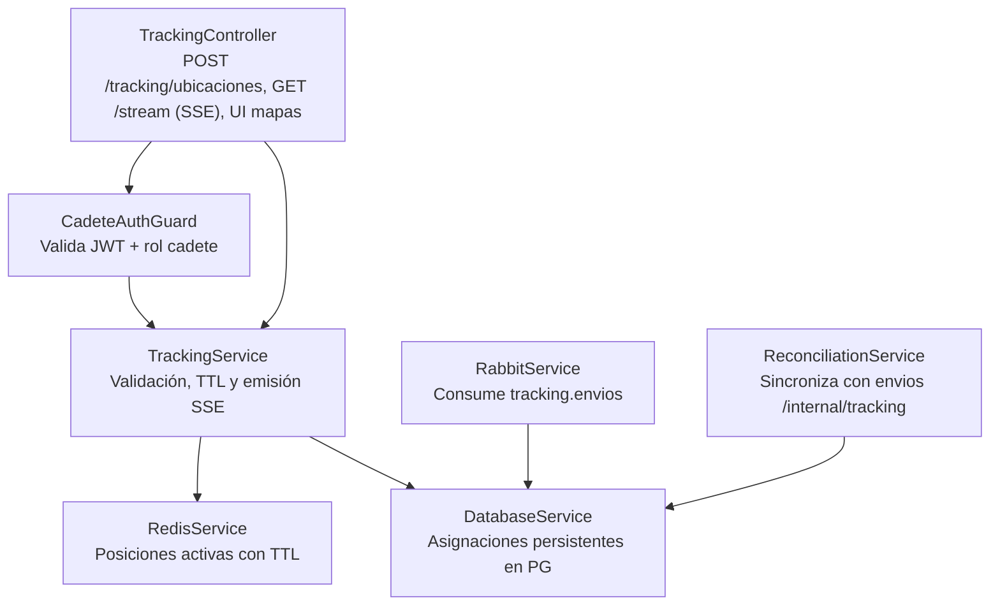
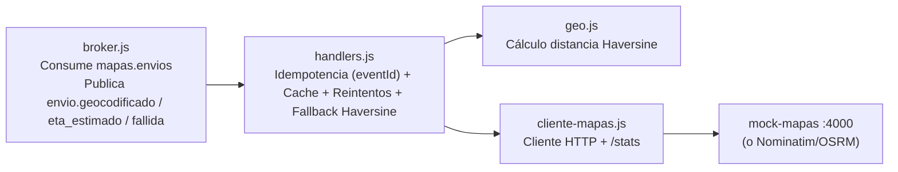

# Diagramas C4 — Operador Logístico Metropolitano (Motomensajería)

Modelado arquitectónico del sistema (**Escenario 3B — UNAHUR**) siguiendo el enfoque C4 en tres niveles: **Contexto**, **Contenedores** y **Componentes**, reflejando el estado integrado en la rama `stg`.

---

## Nivel 1 — Diagrama de Contexto

Muestra a los actores del negocio, el sistema central y la dependencia externa de geocodificación y ruteo.

---

## Nivel 2 — Diagrama de Contenedores

Muestra los contenedores Docker del sistema, sus tecnologías, puertos expuestos, aislamiento de bases de datos (*Database-per-Service*) y canales síncronos/asíncronos.

---

## Nivel 3 — Diagramas de Componentes (Servicios Clave)

### 3.1 API Gateway (`apigateway/`)

### 3.2 Microservicio de Envíos (`envios/`)

### 3.3 Microservicio de Tracking (`tracking/`)

### 3.4 Adaptador de Mapas (`mapas/`)

