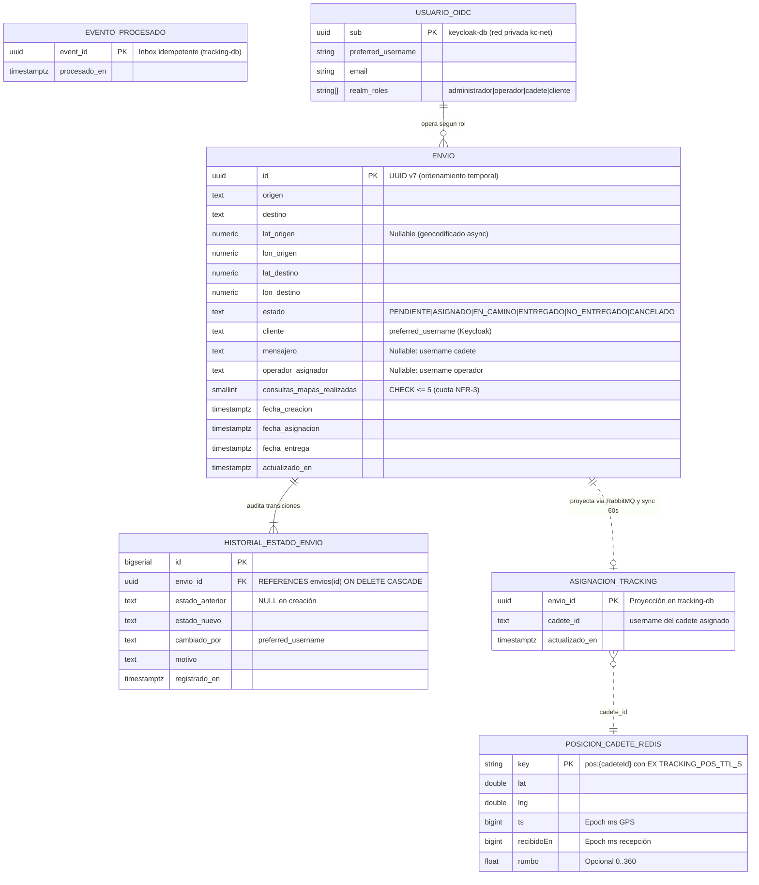

# Modelo del Dominio y Persistencia Distribuida

**Sistema:** Operador Logístico Metropolitano (Motomensajería — Escenario 3B)

Siguiendo el patrón **Database-per-Service** (ADR-003), el modelo de dominio se particiona en contextos delimitados (*Bounded Contexts*) con persistencia independiente y sincronización por eventos de dominio en RabbitMQ (`motomensajeria.events`).

---

## 1. Entidades por Contexto Delimitado

### Resumen de almacenamiento por contexto

| Contexto / Servicio | Motor / Almacén | Entidades / Estructuras | Reglas de negocio principales |
| :--- | :--- | :--- | :--- |
| **Envíos** (`envios`) | `envios-db` (PostgreSQL 16) | `envios`, `historial_estados_envio` | Fuente de verdad transaccional. PK `uuid_v7()`, `SELECT ... FOR UPDATE`, cuota `CHECK (consultas_mapas_realizadas <= 5)` y auditoría obligatoria. |
| **Tracking** (`tracking`) | `tracking-db` (PostgreSQL 16) | `asignaciones`, `eventos_procesados` | Proyección durable de asignaciones e *inbox* de `event_id` con `COMMIT` previo al `ACK` y reconciliación cada 60 s contra `/internal/tracking/asignaciones`. |
| **Tracking Vivo** (`tracking`) | `tracking-redis` (Redis 7, sin disco) | `pos:{cadeteId}` (TTL), canales `tracking:posiciones` y `tracking:estados` | Escritura atómica `MULTI SET EX + PUBLISH` para 120–600 pings GPS/s y expiración automática ante pérdida de señal. |
| **Identidad** (`keycloak`) | `keycloak-db` (PostgreSQL 16, red `kc-net`) | Usuarios, clientes y roles del realm `motomensajeria` | Aislada en `kc-net`; emite tokens JWT (`RS256`) validados vía JWKS. |
| **Mapas** (`mapas`) | Memoria del proceso | `cacheDirecciones`, `cacheRutas`, `envios`, `vistos` (`eventId`) | Deduplica eventos, memoriza direcciones/rutas para reducir costos y calcula fallback Haversine ante fallos externos. |
| **Notificaciones** (`notificaciones`) | Memoria acotada (`<= 200` avisos) | Avisos `{ id, envioId, cliente, mensajero, tipo, mensaje, fecha }`, `vistos` | Deduplica por `eventId`, filtra por rol/ownership y difunde en vivo vía SSE (`GET /notificaciones/stream`). |

---

## 2. Máquina de Estados de `Envio`

El ciclo de vida completo de un envío se gobierna transaccionalmente en `envios`:

```mermaid
stateDiagram-v2
    [*] --> PENDIENTE : POST /v1/envios\n(emite envio.creado)
    PENDIENTE --> ASIGNADO : PATCH /v1/envios/{id}/asignar\no POST /v1/operador/asignaciones\n(emite envio.asignado)
    ASIGNADO --> PENDIENTE : DELETE /v1/operador/asignaciones/{id}\n(liberar asignación;\nemite envio.estado_actualizado)
    ASIGNADO --> EN_CAMINO : PATCH /v1/cadete/envios/{id}/estado\n(estado=EN_CAMINO)
    ASIGNADO --> NO_ENTREGADO : PATCH /v1/cadete/envios/{id}/estado\n(estado=NO_ENTREGADO)
    EN_CAMINO --> ENTREGADO : PATCH /v1/cadete/envios/{id}/estado\n(estado=ENTREGADO)
    EN_CAMINO --> NO_ENTREGADO : PATCH /v1/cadete/envios/{id}/estado\n(estado=NO_ENTREGADO)

    ENTREGADO --> [*]
    NO_ENTREGADO --> [*]
    CANCELADO --> [*] : Estado terminal previsto\nen CHECK de envios-db

    note right of EN_CAMINO
      Habilita seguimiento GPS en vivo
      (GET /v1/tracking/envios/{id}/stream).
      Al pasar a estado final, Tracking libera
      la asignación y cierra streams SSE.
    end note
```

### Invariantes de transición
1. **Asignación exclusiva en `PENDIENTE` (`409 Conflict` en cualquier otro estado):** protegida con bloqueo pesimista `SELECT ... FOR UPDATE`.
2. **Liberación exclusiva en `ASIGNADO` (`409 Conflict` si ya inició viaje o finalizó):** devuelve `mensajero = NULL`, `estado = 'PENDIENTE'` y emite `envio.estado_actualizado`.
3. **Acciones permitidas al cadete (`cadete.js`):** solo puede transicionar envíos asignados a su `preferred_username` hacia `EN_CAMINO`, `ENTREGADO` o `NO_ENTREGADO`; sobre envíos ajenos responde `404 Not Found` (anti-enumeración).
4. **Inmutabilidad de estados terminales (`ENTREGADO`, `NO_ENTREGADO`, `CANCELADO`):** cualquier intento posterior de modificación responde `409 Conflict` con `application/problem+json`.
